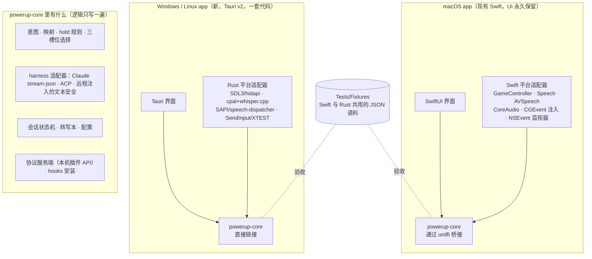

# PowerUp：任意输入设备 × 任意 OS 的落地路线图（2026-09-17 修订版）

> 2026-09-14 的初版由 5 个规划者 + 3 个评审产出，结论是"改而不重写"。
> 2026-09-17 经过一轮逐题拷问（grilling）后修订：结论不变，**形状变了**。
> 修订前后的差异见 §5；词汇以仓库根目录的 `CONTEXT.md` 为准；决定记录在
> `docs/adr/0012`、`0013`，以及修订后的 `0007`。

---

## 0. 结论：改（modify），核心做成库，UI 每个 OS 一套

| 痛点 | 本质 | 做法 |
|---|---|---|
| ① 只有 PS5 好用 | Swift 里的一个 seam 问题 | 不是第一优先级。先把 Mac 现有功能做稳、把逻辑搬进核心、把 Windows / Linux 做出来，**最后**才加新手柄和新设备；非 DualSense 设备交给社区测试 |
| ② 只有 mac | 必须写非 Swift 的新代码 | 建一个 **Rust 核心库** `powerup-core`，编进每个 OS 的 app；Mac 保留 SwiftUI 和全部 Swift 平台适配器，逻辑逐模块搬进核心；Windows 和 Linux 共用一套 **Tauri v2** 界面 |

**为什么不是重写：** 理由和初版一样。Swift app 是唯一在跑、TCC 权限打磨好的产品，带 DESIGN.md 合同和 195 个测试；全量重写意味着七八周没有任何可用产出，还要重新踩 131 条 hidden knowledge 里约 40 条没有测试的坑。

**为什么不是守护进程（初版的 `powerupd`）：** 维护者要的是"前后端分离、逻辑只写一遍"，而不是"两套实现共享合同"。守护进程在 Mac 上会逼着用 Rust 去绑 Apple 的语音、手柄、音频框架，还把 TCC 权限挪到一个子进程上——这正是"改而不重写"要躲开的风险。库的形状把这些全部留在 Swift 里（ADR 0012）。

**开发顺序（维护者原话）：** 先确保现在本地的功能完全没有问题 → 开始往核心搬 → Windows 和 Linux → 新设备、新手柄。

---

## 1. 现状诊断：哪些能带走，哪些焊死在 Apple 上

| 子系统 | 文件（行数） | 纯逻辑占比 | 依赖的 Apple 框架 | 去向 |
|---|---|---|---|---|
| 意图 / 映射 | `Intent.swift` (119)、`Models.swift` (592) | 100% / 92% | 无 | **核心**，第一批搬 |
| Claude 内置 harness | `ClaudeService.swift` (873)、`Harness.swift` (113)、`DestructiveActionClassifier.swift` (38) | 55% / 100% / 100% | Foundation Process/Pipe | `events(fromLine:)` 解析器是仓库里测得最好的纯代码，**核心**，第二批搬；进程管道每个 OS 各写 |
| ACP / 远程 / hooks | `ACPAdapter.swift` (582)、`RemoteListener.swift` (852)、`HookInstaller.swift` (426)、`RemoteControlService.swift` (890) | 85% / 55% / 80% / 35% | Network.framework、CGEvent、AppKit | ACP 状态机、hooks 合并、文本安全规则进**核心**；CGEvent 注入 + Accessibility 是 Mac **平台适配器**；RemoteControlService **零测试** |
| 协议服务器 | `PowerUpProtocol.swift` (193)、`WebSocketFraming.swift` (141) | 100% / 95% | CryptoKit (SHA1) | **核心**；身份是"本机插件 API"，手机路线暂缓 |
| 语音 | `SpeechService.swift` (277)、`TTSService.swift` (677)、`AudioDeviceStore.swift` (194)、`SummaryService.swift` (136) | 15% / 45% / 20% / 70% | Speech、AVFAudio、CoreAudio、NaturalLanguage | 文本规范化 / 语言判定进**核心**；引擎与设备路由是**平台适配器**；生命周期代码零测试 |
| 手柄输入 | `ControllerService.swift` (310) | 15% | GameController、CoreHaptics | Mac **平台适配器**，不动 |
| 编排 | `AppState.swift` (2109) | 55% | AppKit | 搬迁的主体：所有输入汇到 `handle(_ intent:)`、所有 harness 走 `HarnessAdapter`，这两条缝就是切分点；**状态逻辑零测试** |
| UI | `MainView` (910)、`SettingsView` (1052)、`ComponentViews` (1102)、`PowerUpApp` (82) | 5–55% | SwiftUI、AppKit | Mac 的 UI，永久保留；view 里的产品逻辑在阶段 1 补测试时挪出 view |

**两个关键事实：**

- Xbox 手柄今天其实已经能用：`ControllerService.wireButtons` 把任何 `GCExtendedGamepad` 都接到 DualSense 名字上，震动按能力门控。"不好用"= 名字、图标、默认映射、配对文案全是 PS5 的。这就是为什么新设备可以排在最后。
- 仓库里**没有手机功能**。协议端点只监听 127.0.0.1、带 token、设置界面无入口，手机在网络上连不到它。它是给脚本和其他语言写的插件用的本机 API。

**velocity 提醒：** 提交集中在少数几天，是 burst 式产出。下面所有"周"都指专注的 agent 辅助工作周，不是日历周。

---

## 2. 目标架构

| 层 | macOS | Windows | Linux |
|---|---|---|---|
| 产品 | 现有 SwiftUI app（bundle id 不变） | Tauri v2 app | 同一个 Tauri app |
| 核心 | `powerup-core`，uniffi 桥接进 Swift | `powerup-core`，直接链接 | 同 |
| 手柄 | GameController（不动） | SDL3（S4 决定；备选 gilrs + hidapi 裸报文） | SDL3/evdev + udev 规则 |
| 键盘 | 本地 NSEvent monitor（不动；macOS 26 陷阱） | Tauri global-shortcut | X11 XGrabKey；Wayland 仅 portal |
| 语音 | Apple Speech / AVSpeechSynthesizer / CoreAudio（不动，ADR 0011） | cpal → whisper.cpp 子进程；SAPI TTS | 同 Windows；speech-dispatcher TTS |
| 注入 | CGEvent + Accessibility（不动） | SendInput | XTEST；Wayland 按 ADR 0009 降级 |
| 设备槽位 | Controller / Input / Output 各一台，其他一律无视（ADR 0013） | 同 | 同 |
| 本机插件 API | protocol v0，127.0.0.1 + token（不动） | 同 | 同 |
| 契约 | `CONTEXT.md` 词汇 + DESIGN.md 合同 + `Tests/Fixtures/` 共享语料 | 同 | 同 |

**两条设计规则：**

1. 受 TCC 管的一切（麦克风、语音识别、GameController、Accessibility）留在签过名的 Mac app 进程里，由 Swift 适配器采集；核心永远不直接碰硬件。
2. 核心跑在持有 TCC 授权的进程里，所以 **panic 不得穿过桥接边界**：核心的公开接口全部返回 Result，桥接层兜底。

---

## 3. 路线图（每一步都可以直接交给 coding agent）

### 阶段 0 — 已完成（2026-09-17）

- v2.6 键盘 / 鼠标 parity 已提交（`4b117ec`），195 个测试全绿。
- 词汇表 `CONTEXT.md`（20 个术语）、ADR 0012（核心是库）、ADR 0013（三槽位、双 hold 取消）、ADR 0007 修订、ADR 0008 作废、ADR 0010 暂缓。
- DESIGN v2.7 附录：`ControllerAction` 改名 `Action`、三槽位配置项、同设备双 hold 取消、去掉未使用的 `hold` 控件类型、profile 预留 `match` / `report`。

### 阶段 1 — Mac 稳定化：先补齐所有测试，架构不动（2–3 周）

目标：维护者说的"先确保现在本地的功能完全没有问题"。没有测试就无法证明"没有问题"，而这些测试正是阶段 2 每一块搬迁的验收标准。

1. **`AppState` 测试用 initializer + `FakeHarnessAdapter` + `FakeInputSource`。** 跳过 `controller.start()` / `audioDevices.start()` / `syncListener()` / `installKeyMonitor()`，让"设备 → 意图 → harness"这条路第一次能在测试里跑。
2. **会话状态机的 characterization 测试**，录成 `Tests/Fixtures/session/*.json`：resume 失败只重试一次且去掉 `--resume`；`expectedTerminations` 计数与清零；破坏性权限两次按下；`pendingEffortRestart` 推迟到 `turnCompleted`；`remoteActiveTurns` 按 session id + 心跳；`"ultracode\n\n"` 前缀只在内置 Claude 的 max effort；权限模式循环永远到不了 `bypassPermissions`；终止时清 sessionID。
3. **远程模式文本安全测试** `RemoteTextSafetyTests`：`flattenLineBreaks` / `escapeSafeSegments` / `parseWorkspaces` / `stripStatusGlyph` / `condense` / `failureMessage`，今天零测试。
4. **语音生命周期测试**：hold 中麦克风拔出、权限被拒时清 hold、toggle 停止路径清 owner、`derivedStatus` 全部分支、音频设备热插拔回退。
5. **实现 DESIGN v2.7 附录里的行为**（改名、槽位、双 hold 取消、去 `hold` 类型），每条带测试。这是阶段 1 唯一允许的功能改动，因为它是搬迁前必须定型的合同。
6. **把 view 里的产品逻辑挪到可测的地方**（`pushToTalkButtonName`、状态文案、chip 派生），UI 观感不变。
7. **修 bug。** 补测试过程中发现的每个问题都在这个阶段修掉。
8. **并行跑 spike（不改 Mac 代码）：**
   - S1（0.5 天）macOS 26 光条 / 自适应扳机是否还写得进去。**2026-10-28 结果：macOS 27.2 bundle 下光条 NO-GO（蓝牙和 USB 都不行）**（见 `docs/research/spikes/s1-macos-light-bar.md`）。
   - S6（1 天）原生 Windows 上的 Claude Code：SendInput `KEYEVENTF_UNICODE` 打 "hello 世界"；在 `%USERPROFILE%\.claude\settings.json` 注册五个 hook，用 `curl.exe` 验证——**header 是 `X-PowerUp-Token`，不是 `Authorization: Bearer`**；`claude -p --verbose --input-format stream-json --output-format stream-json --include-partial-messages` 的 `system/init` 到达且嵌套 `control_request` 有效。NO-GO(hooks) → WSL2；NO-GO(stream-json) → 阶段 3 先走 ACP。
   - S4（1.5 天）Rust `sdl3` 在 Windows 上收 DualSense 按键、设 LED、震动；init 前 `SDL_HINT_JOYSTICK_ALLOW_BACKGROUND_EVENTS="1"`；先 USB 后蓝牙。阶梯 sdl3 → sdl3-sys → gilrs + hidapi 裸报文（只读格式，不抄 GPL 代码）。
   - S5（1 天）Windows 语音识别对比：10 条中英混杂 + 代码标识符的录音，`whisper-cli small` vs `base` vs `Windows.Media.SpeechRecognition`。GO：small 延迟 < 2.5 s。
   - S7（可选）纯 Swift 文件在 Linux `swift:5.9` 容器里编译——只为确认哪些文件真的纯，不在关键路径上。
   - **砍掉的 spike：** S2（Xbox 在 Mac）、S3（脚踏板在 Mac）、S3b（子进程 TCC 归属）。前两个交给社区测试者，第三个因为没有子进程而不再需要。

退出条件：CI 绿；四块"零测试"区域每块都有夹具；v2.7 行为落地；spike 有 GO/NO-GO 记录。
用户可见收益：更稳的 Mac 版；三槽位设置；改名后的映射。

### 阶段 2 — 把逻辑搬进 `powerup-core`，UI 不动（4–6 周）

目标：Rust 核心库在 Mac app 里替换 Swift 逻辑，一块一块来，每块用阶段 1 的夹具验收。Swift 只剩 UI 和平台适配器。

**kill-switch：** 从阶段 2 开始算第 3 周，如果 uniffi 桥接还不能在签名 .app 里稳定跑第一块，就停下来重新评估桥接方案（C ABI 手写、或改回"共享合同不共享代码"），不要硬撑。

1. **建 cargo workspace `rust/`（同一仓库）：`powerup-core` + `powerup-core-ffi`（uniffi）。** CI 三个 OS runner 跑 `cargo test`；`Tests/Fixtures/` 由 XCTest 和 cargo test 共同读取。`swift build` 通过 SwiftPM binary target 或 `scripts/build.sh` 链接 `.xcframework`。DESIGN.md 加附录规定桥接层的 Swift 侧签名。
2. **第一块：意图映射 + hold 规则 + 三槽位选择。** `powerup-core/src/{intent,mapping,hold,slots}.rs`。`Action` 的 serde 必须读写 Swift 合成的 Codable 形状（`{"approve":{}}`、`{"sendPrompt":{"_0":"…"}}`），用一份真实的 `config.json` 做 fixture；容错逐条解码；lossy 保存前先备份。Swift 的 `IntentMapper` 与 `AppState.handleControl` 改为调用核心。
   验证：`IntentMapperTests` / `DeviceProfileTests` / `AppConfigTests` 的用例作为 Rust fixture 通过；Mac app 行为无变化。
3. **第二块：Claude stream-json 解析器 + 会话状态机。** `powerup-core/src/harness/{claude,session}.rs`。必保清单：嵌套 `control_request` 带 `request_id`；`--verbose` 必填；`--include-partial-messages`；assistant 消息按 content block 到达多次；`isError = is_error || subtype != "success"`；忽略 `system` 的 status/hook_started/…、`rate_limit_event`、所有 `type:"user"` 行；从 `control_response` 回显刷新模型名；effort 变更带 `--resume` 重启；16 MB 行保护；kill 前 2 s 宽限。进程管道留在 Swift（`Process`/`Pipe`），核心只吃行、吐事件。
   验证：`ClaudeStreamParsingTests` 每个用例作为 Rust fixture 通过；阶段 1 的 session characterization 全过。
4. **第三块：ACP 适配器状态机。** initialize → `session/new`；剥离 `CLAUDECODE` / `CLAUDE_CODE_*` / `CLAUDE_PID`；`agent_thought_chunk` 永不进入回复；权限回应优先 `*_once`；30 s 启动看门狗。脚本化 mock agent 场景在三平台 CI 上通过。
5. **第四块：配置、转写本 JSONL、hooks 安装的 JSON 合并、远程文本安全规则、语音文本规范化与语言判定。** 路径用 `dirs` crate，同一 schema，Mac 用户的映射文件在 Windows 直接能用。
6. **第五块：协议服务端（HTTP `/event` + WS `/ws`）的策略层。** 只绑 127.0.0.1；token hello；非空 Origin → 403；连接上限；空闲期限；`/event` 先回 204。Network.framework 的监听留在 Swift，核心只做帧解析和策略。
7. **`PORTING-LEDGER.md`：** 131 条 hidden knowledge 每条一行 {item, 归属, 处置 `test` / `doc-comment` / `N/A`, 状态}；CI 一条 grep，有 `todo` 就失败。

退出条件：`AppState` 只剩 UI 状态和适配器接线；核心在三个 OS runner 上测试全绿；Mac app 对用户零变化。
用户可见收益：无（这就是重点：搬迁期间 Mac 用户什么都不会坏）。

### 阶段 3 — Windows 和 Linux：一套 Tauri v2 app（8–10 周）

目标：Windows 11 和 Linux X11 上，同一个 Tauri app 提供 Mac 用户能做的一切。主力支持 DualSense + 键盘鼠标 + 耳机麦克风；harness 是 Claude Code（stream-json）、Codex 和 opencode（ACP）。**不做命令行前端；Mac 也没有。**

1. **Rust 平台适配器：** `powerup-platform-{windows,linux}` — 手柄（按 S4 选的栈，profile id 与 control id 与 Mac 完全相同）、键盘（Tauri global-shortcut / XGrabKey）、语音采集（cpal → whisper.cpp 子进程，永不用 FFmpeg 标志构建；模型下载显式带大小）、TTS（SAPI / speech-dispatcher）、注入（SendInput 每个 UTF-16 单元一次 `KEYEVENTF_UNICODE`，清修饰键；XTEST）、hooks 投递（`powerup hook-relay` 子命令，读 stdin 立刻退出）。
2. **Tauri 界面：** 顶栏 chips、Allow → Confirm 的权限横幅、五种气泡 + 流式转写、带麦克风按钮的输入框、设置（General / Voice / Buttons / Feedback / Remote）、三槽位选择器、由 profile 渲染的映射编辑器。webview 里永远不直接开 ws://，用 Tauri IPC。**Tauri 搭建限时 3 天**；只有撞上具体阻塞才按 ADR 0007 的条款考虑 Electron。
3. **Linux 注入与运行时探测：** `XDG_SESSION_TYPE`、portal 可用性；wlroots 系明确提示"此处不支持，请用 cmux"而不是沉默（ADR 0009）。udev 规则模板写进 `docs/getting-started-linux.md`。
4. **分发：** Windows 先未签名 zip + SmartScreen 文案，Azure Trusted Signing 推迟到公开构建；Linux AppImage / .deb。新建 `docs/getting-started-windows.md`。

退出条件：一台干净的 Windows 11 和一台 Ubuntu X11 上，按文档 10 分钟内完成 手柄 → 语音 → 打字 → 琥珀 → TTS 闭环；内置模式与远程模式都可用；共享 fixtures 在所有 runner 通过。
用户可见收益：**PowerUp 第一次在 Windows 和 Linux 上能用。痛点②解决。**

### 阶段 4 — 新设备、新手柄，plugin list（3–4 周，之后由社区延续）

目标：痛点①。此时三个 OS 的输入通路都已经走 (profile, control, phase)，加设备就是加 profile 和适配器。

1. **Xbox / 通用手柄 profile：** Mac 上 `ControllerService` 按 `productCategory` 分 dualsense / xbox / generic-gamepad，Xbox 用自己的 control id（`a b x y lb rb lt rt …`），不复用 `cross/circle`；Windows / Linux 同一批 id。映射编辑器、侧栏、速查表、配对文案全部 profile 驱动。
2. **键盘 profile（F13–F24）：** Mac 用 CGEvent session tap（默认关，只监听不吞；媒体键要吞就要 Accessibility），Windows / Linux 用阶段 3 的全局快捷键。⌘D 等本地快捷键原封不动。
3. **社区 profile 的文件格式：** 控件列表 + 默认映射 + 识别规则（厂商 id、产品 id、产品类别、名称）；`report` 段预留不解析，以后自定编码。协议 v0 加 `registerDevice` / `control` / `deviceState`，注册的设备只能到达用户映射过的动作，hold 动作需要每设备的"允许控制麦克风"开关。
4. **plugin list：** 设置里一个列表，列出编译进核心的官方 profile / 适配器和运行时注册的社区项，每项可开关。可下载安装的插件包不在本阶段。
5. **文档：** `docs/devices.md` 每个 profile 一张表；`docs/protocol.md` 写清楚"贡献者不改任何一个 app 就能加设备"；用一个社区踏板 profile dogfood 一遍。

退出条件：Xbox 手柄在三个 OS 上名字、图标、默认映射、震动全对；一个 30 行的脚本能注册假踏板并触发 PTT；plugin list 能开关它。

### 阶段 5 — 长尾（持续）

唤醒词（openWakeWord，作为协议设备）；Kokoro TTS；每个后端的代码词汇偏置（#22）；"套装"（一键切换三个槽位的组合）；可安装的插件包；手机遥控（ADR 0010 的 TLS 与证书信任）——**全部暂缓**，等前四个阶段出货后按需求排。

---

## 4. 贯穿全程的治理

| 机制 | 内容 |
|---|---|
| `CONTEXT.md` 是词汇的唯一来源 | 议题、PR、测试名、ADR 都用它的词；出现新词先进词汇表再进代码 |
| `Tests/Fixtures/` 共享语料 | XCTest 与 cargo test 读同一批 JSON/JSONL；CI 断言目录非空；PR 勾选框"spec-first：fixture 或 N/A" |
| 先 characterization 再搬迁 | 阶段 1 的全部测试是阶段 2 每一块的验收标准；任何会话 / 远程 turn 逻辑不许逐行移植 |
| `PORTING-LEDGER.md` | 131 条 hidden knowledge 逐条记录处置，CI 有 `todo` 就失败 |
| kill-switch | 阶段 2 第 3 周桥接不稳就停；阶段 3 Tauri 搭建限时 3 天 |
| TCC 与 panic 规则 | 受 TCC 管的一切留在签名 .app 内由 Swift 采集；核心 panic 不得穿过桥接边界 |
| 每个阶段都是一个 release | 任何阶段结束都能停；后面的阶段不是前面收益的前提 |
| schema-as-code | `docs/schema/device-profile.json` 与 `protocol-v0.json` 从 Rust 的 schemars 生成并在 CI diff；`LICENSE-THIRD-PARTY.md` 从第一个 Rust commit 起生成 |

---

## 5. 相对初版的改动，以及 ADR 现状

| 初版 | 修订版 | 记录在 |
|---|---|---|
| Rust 是 headless 守护进程 `powerupd`，UI 是协议客户端 | Rust 是**库**，编进每个 OS 的 app；协议只服务本机插件 | ADR 0012 |
| Swift app 与 Rust 共享合同和夹具、不共享代码；Phase 6 再做收敛决策 | Swift 保留 UI 和适配器，逻辑搬进核心；没有"收敛决策"，因为只有一套逻辑 | ADR 0012（取代 0008） |
| Phase 2：Rust 设备插件打包进 Mac app | 砍掉；Mac 不需要 Rust 设备代码 | ADR 0012 |
| Phase 1（任意设备在 Mac）排第一 | 排最后（阶段 4）；非 DualSense 设备交社区测试 | 本文 §0 |
| 所有设备同时活跃，first-assert-wins 仲裁，按 (profileId, controlId) 归属 | 三个槽位各一台设备，其他一律无视；没有跨设备仲裁 | ADR 0013 |
| 同设备第二个 hold 被忽略 | 两个一起取消并丢弃，给震动或提示音 | ADR 0013（修正 0006） |
| Windows 先做无 GUI 的注入模式 | 一开始就是 Tauri 窗口；不做命令行前端 | ADR 0007 修订 |
| stream-json 解析器不移植 | 移植 | ADR 0007 修订 |
| Tauri 与 egui 二选一待定 | Tauri v2 确定，Windows 和 Linux 共用一套 | ADR 0007 修订 |
| 手机 / iOS 证书信任是 M7 路线 | 暂缓 | ADR 0010 状态 |
| `ControllerAction`、`hold` 控件类型 | 改名 `Action`；去掉 `hold` 类型，hold 是动作的属性 | DESIGN v2.7、`CONTEXT.md` |
| "Controller" = 游戏手柄 | "Controller" = 任何提供按键的设备，也是槽位名；"Device" 是总称 | `CONTEXT.md` |

ADR 一览：0006 接受（hold 语义由 0013 修正）；0007 接受并修订；0008 被 0012 取代；0009 接受原文，排最后；0010 暂缓；0011 接受（mac 语音留在 Swift，其余按 S5）；0012、0013 新增并接受。

---

## 6. 风险与对策

| 风险 | 可能性 | 对策 |
|---|---|---|
| uniffi 桥接在签名 .app 里不稳、或 Swift 侧生成代码难以维护 | 中 | 阶段 2 第一块就是最小的一块，专门用来验证桥接；第 3 周 kill-switch |
| 核心 panic 带倒持有 TCC 授权的 Mac 进程 | 中 | 公开接口全部 Result；桥接层 `catch_unwind` 兜底；CI 里 `#![deny(clippy::unwrap_used)]` |
| 逐行移植 AppState 丢掉边角修复 | 高（若天真移植） | 阶段 1 先把四块零测试区域全部录成夹具；阶段 2 每块验收 |
| 原生 Windows 的 Claude Code hooks / stream-json 与 mac 验证过的行为不同 | 中 | S6 先验；备选 WSL2 与 ACP；Windows 录的 fixture 与 mac 的并排放 |
| `sdl3` crate 仍在稳定中 | 中 | S4 限时走完 sdl3 → sdl3-sys → gilrs + hidapi；profile id 与栈无关 |
| whisper.cpp 在中英混合 + 代码标识符上延迟 / 准确率差 | 中 | S5 固定语料对比；`--prompt` 偏置；云 STT 永不成为静默默认 |
| Tauri 在 Linux 依赖 webkitgtk，包体大、发行版差异 | 中 | AppImage 打包 webkitgtk；Electron 是 ADR 0007 写明的兜底 |
| 一个 Swift 代码库 + 一个 Rust 代码库拖垮 solo 维护者 | 中 | 逻辑只在 Rust；Swift 只剩 UI 和适配器，改动频率低；每个阶段独立可发布 |
| 社区没有人测非 DualSense 设备 | 中 | 阶段 4 的 profile 格式和 plugin list 把门槛降到"写一个 JSON"；issue 模板加"我有 X 设备愿意测" |
| 估算偏乐观 | 高 | 每个阶段的退出条件都是一个 release；阶段 1 单独让 Mac 更稳；阶段 3 单独解决痛点② |

---

## 7. 明确不做什么

- **守护进程 / headless 模式 / 命令行前端**：任何 OS 都不做。
- **Rust 绑 Apple 框架**（objc2-speech 等）：Mac 语音、手柄、音频永远在 Swift。
- **Mac 端的 Rust 设备插件**、**子进程 TCC 归属 spike**：没有子进程。
- **跨设备 hold 仲裁**：三槽位之外的设备一律无视，没有"抢"。
- **egui**、**Electron**（除非 Tauri 撞上 ADR 0007 写明的具体阻塞）。
- **手机 app、iOS 证书信任、listener TLS**（ADR 0010）：暂缓。
- **Swift-everywhere**（swift-corelibs-foundation 移植）：Combine 没有开源实现，每个碰硬件的文件都是 Apple 框架形状。
- **Linux 先于 Windows**、**Wayland parity**（按 ADR 0009 降级发布，最后做）。
- **可下载安装的插件包、插件市场**：等 plugin list 里出现第一个社区项再说。

---

## 8. 时间线总览（专注的 agent 辅助周，不是日历周）

| 累计周 | 阶段 | 你能做到而今天做不到的事 |
|---|---|---|
| 0 | 阶段 0 | 已完成：v2.6 提交、词汇表、ADR、v2.7 合同 |
| 2–3 | 阶段 1 | Mac 版四块零测试区域全部有夹具；三槽位设置；spike 有答案 |
| 6–9 | 阶段 2 | Mac app 的逻辑全部在 `powerup-core`，用户零感知 |
| 14–19 | 阶段 3 | **Windows 和 Linux 可用**：同一个 Tauri app，DualSense + 键盘 + 耳机，Claude Code / Codex / opencode |
| 17–23 | 阶段 4 | Xbox 与键盘 profile 在三个 OS 上一等公民；社区能写 profile；plugin list |
| 之后 | 阶段 5 | 唤醒词、Kokoro、词汇偏置、套装、可安装插件、手机 |

第一件要做的事：阶段 1 第 1 步——给 `AppState` 加测试用 initializer，让"设备 → 意图 → harness"这条路第一次能在测试里跑。
